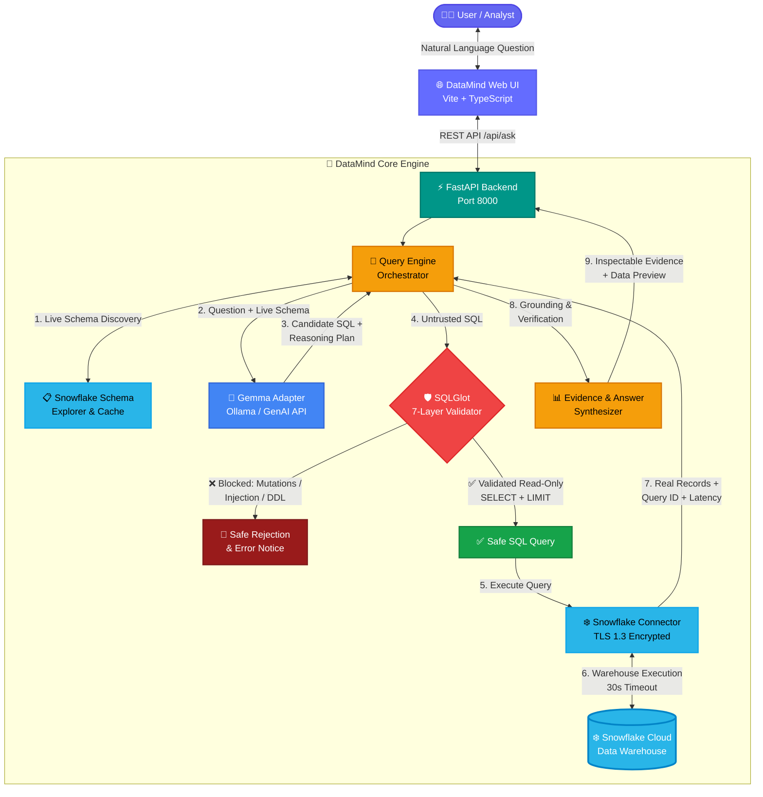
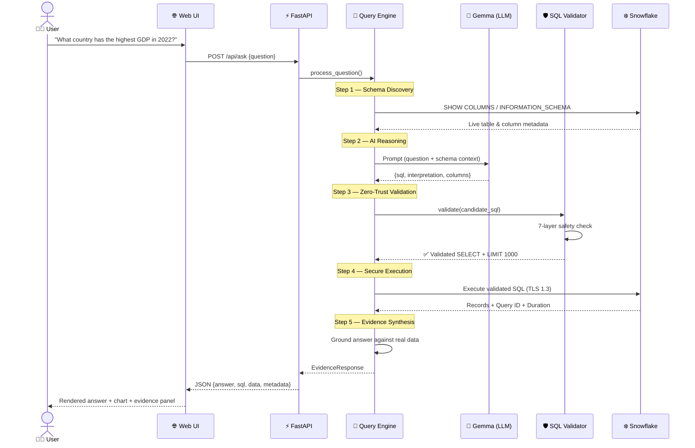
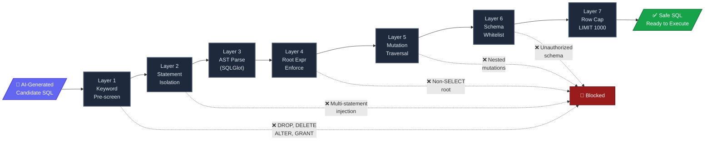

# 🧠 DataMind — Talk to Your Data

> **PS1 | ZeroDay OSS Hacktoberfest 2026 | IIIT Dharwad**  
> AI-powered natural-language data analysis agent using **Google Gemma** and **Snowflake**, fortified with a **Zero-Trust SQL Validation Layer**.

*Last updated: October 18, 2026*

[](https://opensource.org/licenses/MIT)
[](https://www.python.org/downloads/)
[](https://fastapi.tiangolo.com)
[](https://www.snowflake.com/)
[](https://ai.google.dev/gemma)
[](https://vitejs.dev/)
[]()

---

## 🌟 Executive Summary

**DataMind** is an open-source analytical platform that empowers non-technical and technical users alike to converse with structured cloud datasets using natural language. Rather than relying on simulated queries, hardcoded dictionaries, or hallucinated numbers, DataMind executes a strict **Zero-Trust Analytical Pipeline**:

$$\text{Natural-Language Question} \longrightarrow \text{Gemma Schema Reasoner} \longrightarrow \text{SQLGlot Multi-Layer Validator} \longrightarrow \text{Snowflake Cloud Warehouse} \longrightarrow \text{Evidence-Backed Grounded Synthesis}$$

Every claim, numeric metric, and percentage returned is verified against real data queried at question time from Snowflake, accompanied by a complete audit trail (executed SQL, query latency, Snowflake Query ID, and data preview).

---

## 🏗️ System Architecture

### High-Level Overview



### 🔄 Request Lifecycle — Sequence Diagram



### 🛡️ Security Pipeline — 7 Layers of Defense



### 🧩 Component Overview

| Layer | Component | Technology | Responsibility |
|:---:|---|---|---|
| 🌐 | **Web UI** | Vite + TypeScript + Vanilla CSS | Reactive SPA with dark-mode design, SVG charts, schema explorer, evidence inspector |
| ⚡ | **API Server** | FastAPI (Python 3.10+) | REST endpoints (`/api/ask`, `/api/schema`, `/api/health`), CORS, lifespan management |
| 🎯 | **Query Engine** | Python | Pipeline orchestration: intent detection → SQL generation → validation → execution → synthesis |
| 🤖 | **Gemma Adapter** | Ollama / Google GenAI | Schema-aware prompt engineering, candidate SQL generation, JSON/SQL response extraction |
| 🛡️ | **SQL Validator** | SQLGlot (Snowflake dialect) | 7-layer zero-trust validation: keyword filter → AST parse → mutation scan → schema check → row cap |
| ❄️ | **Snowflake Adapter** | snowflake-connector-python | Connection pooling, schema discovery, query execution with 30s timeout, TLS 1.3 encryption |
| 📊 | **Synthesizer** | Python | Evidence grounding, answer verification, audit trail assembly (SQL, Query ID, latency, preview) |

### 🔧 Tech Stack

| Category | Technologies |
|---|---|
| **AI / LLM** | Google Gemma 3 (4B) / Gemma 2 (9B) via Ollama, Google GenAI API |
| **Backend** | Python 3.10+, FastAPI, Uvicorn, Pydantic v2 |
| **Database** | Snowflake Cloud Data Warehouse, snowflake-connector-python |
| **SQL Safety** | SQLGlot (AST parsing, Snowflake dialect) |
| **Frontend** | Vite, TypeScript, Vanilla CSS (1,000+ line design system) |
| **Testing** | Pytest (79 tests), custom evaluation benchmarks |
| **DevOps** | Git, GitHub, MIT License |

---

## ✨ Key Features (Requirements M1–M8)

| Feature | Description |
|---|---|
| **M1: Natural-Language Interaction** | Query structured datasets without writing SQL. Full support for filtering, ranking, aggregation, multi-year comparisons, and sorting. |
| **M2: Real Data at Question Time** | Zero hardcoding or fake mocks. Queries run against live Snowflake tables at query time. |
| **M3: Grounded Answers** | Answers are mathematically derived from verified query records; zero hallucinations of numbers, dates, or trends. |
| **M4: Transparent Explanations** | Explains what was measured, which filters were applied, and assumptions made. |
| **M5: Inspectable Evidence** | Users can inspect proposed SQL vs. executed SQL, referenced tables/columns, execution duration (ms), row count, and Snowflake Query ID. |
| **M6: Ambiguity & Error Handling** | Detects underspecified questions (e.g. "show best countries") and prompts for clarification; gracefully handles missing columns, empty results, and timeouts. |
| **M7: Genuine Gemma & Snowflake Roles** | Gemma performs real reasoning (schema resolution, SQL construction, grounding); Snowflake executes data retrieval and aggregation. |
| **M8: Reproducible & Open-Source** | Fully containerizable, verified test suite (79 unit/safety/pipeline tests), sample dataset DDL/DML, and MIT License. |

---

## 🛡️ Zero-Trust SQL Safety Guarantee

DataMind treats all model-generated SQL as **untrusted user input**:

1. **Layer 1: Dangerous Keyword Pre-screening**: Regular expression filters block destructive verbs (`INSERT`, `UPDATE`, `DELETE`, `DROP`, `ALTER`, `CREATE`, `TRUNCATE`, `GRANT`, `REVOKE`, etc.).
2. **Layer 2: Statement Isolation**: Blocks multiple stacked statements (`;` injection) while safely allowing comments and string literals.
3. **Layer 3: Abstract Syntax Tree (AST) Parsing**: Parsed using `sqlglot` under the Snowflake dialect.
4. **Layer 4: Root Expression Enforcement**: Strictly `exp.Select` allowed (CTEs permitted only if the root expression resolves to a SELECT).
5. **Layer 5: AST Mutation Traversal**: Deep AST walk to detect embedded mutation expressions.
6. **Layer 6: Schema Whitelist Verification**: Verifies referenced tables against permitted databases and schemas (`DATAMIND_DB.PUBLIC.*`).
7. **Layer 7: Automatic Row Capping**: Injects `LIMIT 1000` to prevent unbounded query costs or warehouse memory exhaustion.

---

## 📊 Dataset Specification

DataMind includes a verified benchmark dataset: **`WORLD_INDICATORS`** (2018–2022).
- **Origin**: World Bank Open Data & Our World in Data.
- **Licence**: Creative Commons Attribution 4.0 International ([CC-BY 4.0](https://creativecommons.org/licenses/by/4.0/)).
- **Attributes**: `COUNTRY`, `COUNTRY_CODE`, `CONTINENT`, `YEAR`, `GDP_USD`, `POPULATION`, `LIFE_EXPECTANCY`, `CO2_EMISSIONS_PER_CAPITA`, `INTERNET_USERS_PCT`.

---

## 🚀 Quick Start Guide

### 1. Prerequisites
- Python 3.10+
- Node.js 18+ and npm
- Ollama with Gemma (or access to Google GenAI)
- Snowflake Account (or Snowflake Trial)

### 2. Backend Setup
```bash
# Clone the repository
git clone https://github.com/ZERODAY-2026/BROCODE.git
cd BROCODE

# Install backend dependencies
cd backend
pip install -r requirements.txt

# Configure environment variables
cp ../.env.example ../.env
# Edit .env with your Snowflake credentials and Gemma settings
```

### 3. Gemma Setup (Local Ollama)
```bash
# Install and run Ollama
ollama run gemma3:4b
# Or gemma2:9b
```

### 4. Snowflake Setup & Dataset Loading
Execute [`scripts/setup_dataset.sql`](scripts/setup_dataset.sql) in Snowflake Snowsight, or run:
```bash
python scripts/load_sample_data.py
```

### 5. Frontend Setup
```bash
cd ../frontend
npm install
npm run dev
```
Open [http://localhost:5173](http://localhost:5173) in your browser.

### 6. Run the Backend Server
```bash
cd ../backend
uvicorn app.main:app --host 0.0.0.0 --port 8000 --reload
```

---

## 🧪 Testing & Verification

Run the full automated test suite (79 tests covering models, SQL safety, Gemma adapter, query engine, and API endpoints):

```bash
# Run backend tests
python -m pytest backend/tests -v
```

Run the independent correctness evaluation benchmark:
```bash
python scripts/evaluate_correctness.py
```

Run the critical data-change test (verifies results update when Snowflake data updates):
```bash
python scripts/data_change_test.py
```

---

## 📁 Repository Structure

```
BROCODE/
├── .env.example              # Sample environment configuration template
├── .gitignore                # Git ignore rules (secrets, venvs, dist)
├── LICENSE                   # Open-source MIT License
├── README.md                 # Master project documentation
├── backend/
│   ├── app/
│   │   ├── config.py         # Pydantic environment configuration
│   │   ├── gemma_adapter.py  # Gemma reasoning & SQL generation adapter
│   │   ├── main.py           # FastAPI application endpoints & lifespan
│   │   ├── models.py         # Type-safe Pydantic request/response schemas
│   │   ├── query_engine.py   # Core question-to-evidence pipeline coordinator
│   │   ├── snowflake_adapter.py # Snowflake connector & schema explorer
│   │   └── sql_validator.py  # Zero-Trust SQLGlot AST safety validator
│   ├── pyproject.toml        # Project metadata
│   ├── requirements.txt      # Python dependencies
│   └── tests/
│       ├── test_api.py       # FastAPI endpoint tests
│       ├── test_gemma.py     # Gemma prompt & JSON parsing tests
│       ├── test_integration.py # Live integration tests (Snowflake/Gemma)
│       ├── test_models.py    # Schema & Pydantic validation tests
│       ├── test_query_engine.py # End-to-end pipeline orchestration tests
│       └── test_sql_validator.py # Multi-layer SQL security & injection tests
├── frontend/
│   ├── index.html            # Web entry point
│   ├── package.json          # Frontend dependencies & scripts
│   ├── tsconfig.json         # TypeScript configuration
│   ├── vite.config.ts        # Vite configuration with API proxy
│   └── src/
│       ├── index.css         # Complete 1,000+ line dark-mode design system
│       └── main.ts           # Reactive TypeScript application & SVG charts
├── docs/
│   ├── ARCHITECTURE.md       # In-depth architectural & security specification
│   ├── DATASET.md            # Dataset specification, attribution, & DDL
│   └── evaluation_results.json # Automated evaluation benchmark output
└── scripts/
    ├── data_change_test.py   # Live data-change verification script
    ├── evaluate_correctness.py # Automated correctness benchmark runner
    ├── load_sample_data.py   # Automated Snowflake data loader
    └── setup_dataset.sql     # Standalone Snowflake worksheet DDL/DML script
```

---

## 📄 Open-Source Licence & Attribution

- **Application Code**: Licensed under the [MIT License](LICENSE).
- **Dataset**: [World Bank Open Data](https://data.worldbank.org) and [Our World in Data](https://ourworldindata.org) ([CC-BY 4.0](https://creativecommons.org/licenses/by/4.0/)).
- **Model**: [Google Gemma](https://ai.google.dev/gemma) is subject to the [Gemma Terms of Use](https://ai.google.dev/gemma/terms).

---

*Built with passion for ZeroDay OSS Hacktoberfest 2026 | IIIT Dharwad.*
